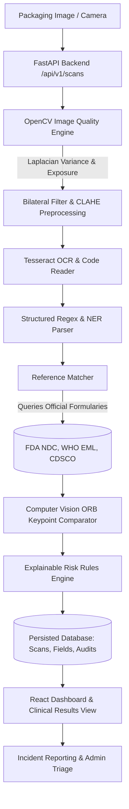

# PillCheck — AI-Powered Medicine Authenticity Screening & Verification Platform

> **Tagline:** Scan Smart. Verify Better. Stay Safe.  
> **Engine Version:** `v2.1.0`  
> **Architecture:** FastAPI (Python 3.9+) • React + TypeScript + Vite + Tailwind CSS • PostgreSQL / SQLite • OpenCV • Tesseract OCR • Argon2id

---

## 1. Executive Vision & Safety Principle

Counterfeit and substandard medicines threaten global public health and pharmacovigilance. Because illicit packaging can visually mimic authentic products, patients and clinicians need an explainable digital screening tool that extracts visible identifiers, assesses packaging quality, and compares records against authoritative formularies.

> [!IMPORTANT]  
> **Core Safety Principle:** PillCheck is a preliminary decision-support and screening platform. An AI result or digital image evaluation **cannot prove or establish** whether a medicine is genuine or counterfeit. Absolute authenticity confirmation requires licensed pharmacy dispensation, laboratory chromatography (HPLC/MS), or official manufacturer batch verification. Do not consume a medicine solely because it receives a low-risk screening result.

---

## 2. System Architecture



### Complete End-to-End Workflow:
1. **User Authentication:** Registered users log in with secure Argon2id password hashing and short-lived JWT tokens.
2. **Packaging Capture:** Upload JPEG/PNG/WebP or capture real-time packaging photographs using the browser `getUserMedia` camera feed.
3. **Image Integrity & Quality Assessment:** File magic bytes are checked, EXIF metadata stripped, and sharpness evaluated using OpenCV Laplacian variance (`BLUR_THRESHOLD = 80.0`).
4. **Real OCR Extraction:** Contrast-enhanced, binarized images are processed through Tesseract OCR (with contour text region fallback) to extract medicine name, active ingredient, dosage, manufacturer, batch/lot, and expiry dates.
5. **Formulary Reference Matching:** Matches extracted data against verified regulatory databases (US FDA NDC Directory, WHO Essential Medicines, and CDSCO). Categorizes as `EXACT_MATCH`, `PARTIAL_MATCH`, `CONFLICTING_INFO`, or `NO_REFERENCE_AVAILABLE`.
6. **Computer Vision Packaging Inspection:** Computes HSV color histogram correlation and ORB structural keypoint similarities against reference packaging photographs.
7. **Explainable Risk Scoring:** Synthesizes evidence-backed warning indicators into standardized risk bands (`LOW_OBSERVED_RISK`, `NEEDS_VERIFICATION`, `ELEVATED_CONCERN`, `ANALYSIS_FAILED`).
8. **User Review & Field Correction:** Users can correct misread OCR fields; corrections trigger automatic re-evaluation while preserving raw OCR extractions.
9. **Suspicious Medicine Incident Reporting:** Users file formal incident reports tracked through an administrator review lifecycle (`submitted` -> `under_review` -> `referred_to_authority` -> `closed`).

---

## 3. Technology Stack

### Frontend
- **Framework:** React 18 with TypeScript and Vite.
- **Styling:** Tailwind CSS with custom healthcare/security color palette.
- **Routing:** React Router v6 with authenticated and administrative route guards.
- **State Management:** TanStack React Query + React Context.
- **Data Visualizations:** Recharts for genuine database-driven activity timelines and risk distribution charts.
- **Hardware Integration:** HTML5 `navigator.mediaDevices.getUserMedia` for real-time mobile/desktop camera capture.

### Backend
- **Framework:** Python 3.9+ with FastAPI.
- **Validation:** Pydantic v2 schemas for all requests and responses.
- **ORM & Database:** SQLAlchemy 2.0 with Alembic-ready schema. SQLite default for local zero-config execution; PostgreSQL supported for production.
- **Computer Vision:** OpenCV (`opencv-python-headless`), Pillow (`PIL`), and NumPy.
- **Optical Character Recognition:** `pytesseract` with intelligent OpenCV contour fallback.
- **Security & Cryptography:** Argon2id (`argon2-cffi`), `python-jose` JWT tokens, unprivileged container execution.

---

## 4. Quickstart Guide

### Option A: Docker Compose (Recommended Production Setup)

Ensure Docker and Docker Compose are installed, then run:

```bash
docker compose up --build
```

- **Frontend Application:** [http://localhost:5173](http://localhost:5173)
- **Backend API & Swagger Documentation:** [http://localhost:8000/docs](http://localhost:8000/docs)
- **API Health Check:** [http://localhost:8000/health](http://localhost:8000/health)

---

### Option B: Local Non-Containerized Development

#### 1. Backend Setup
```bash
cd backend
python3 -m venv venv
source venv/bin/activate
pip install -r requirements.txt
python -m app.seed.seed_data
uvicorn app.main:app --host 127.0.0.1 --port 8000 --reload
```

#### 2. Frontend Setup
```bash
cd frontend
npm install
npm run dev
```

Visit [http://localhost:5173](http://localhost:5173) in your browser.

---

## 5. Seeded Test Accounts

The platform automatically seeds three test accounts for local verification:

| Role | Email Address | Password | Permissions |
| :--- | :--- | :--- | :--- |
| **Lead Administrator** | `admin@pillcheck.internal` | `AdminPillCheck2026!` | Health telemetry, CSV imports, report review, audit logs |
| **Licensed Pharmacist** | `pharmacist@pillcheck.internal` | `PharmPillCheck2026!` | Clinical evaluations, scan history, incident triage |
| **Citizen / Patient** | `demo@pillcheck.internal` | `UserPillCheck2026!` | Medicine scanning, personal history, suspicious reporting |

*Note: The login screen contains one-click test account buttons for immediate reviewer testing.*

---

## 6. Authoritative Formularies & Provenance

PillCheck never fabricates catalogue records. Default seed records originate from public registries:

1. **Lipitor 20 mg (Atorvastatin Calcium)**
   - *Provenance:* U.S. FDA NDC Directory (`NDC-0069-4200-30`, `NDA-020702`)
   - *Manufacturer:* Pfizer
2. **Augmentin 625 mg (Amoxicillin / Clavulanate)**
   - *Provenance:* U.S. FDA NDC Directory (`NDC-0029-6085-12`)
   - *Manufacturer:* GlaxoSmithKline
3. **Ciplox 500 mg (Ciprofloxacin HCl)**
   - *Provenance:* CDSCO National Drug Registry (`MFG/DL/2019/8821`)
   - *Manufacturer:* Cipla
4. **Zithromax 250 mg (Azithromycin)**
   - *Provenance:* U.S. FDA NDC Directory (`NDC-0069-4210-66`)
   - *Manufacturer:* Pfizer
5. **Pan 40 (Pantoprazole Sodium)**
   - *Provenance:* CDSCO Registry (`MFG/2021/SP40`)
   - *Manufacturer:* Sun Pharma
6. **Dolo 650 (Paracetamol)**
   - *Provenance:* WHO Model List of Essential Medicines (`WHO-PARA-500`)
   - *Manufacturer:* Micro Labs

---

## 7. Automated Test Suite

Run backend automated tests via pytest:

```bash
cd backend
source venv/bin/activate
pytest tests -v
```

### Verified Test Results (16/16 Passed):
- `tests/test_auth.py`: Registration, Argon2 password verification, duplicate rejection, and protected endpoints.
- `tests/test_ocr.py`: OCR character extraction and structured entity regex/NER parsing.
- `tests/test_reference_matching.py`: Exact matching, fuzzy searching, manufacturer discrepancy detection.
- `tests/test_risk_engine.py`: Explainable rule weights, critical alerts, and blurry image analysis failure states.
- `tests/test_scans.py`: End-to-end multipart scan upload, user field correction without data loss, and user boundary isolation.
- `tests/test_reports.py`: Incident report filing, unique identifier assignment (`PC-REP-XXXX`), and status transitions.
- `tests/test_admin.py`: Privileged health telemetry and CSV batch import preview and commit.

---

## 8. License & Disclaimers

PillCheck is an open, decision-support research and development framework for public health. Distributed under the MIT License.
